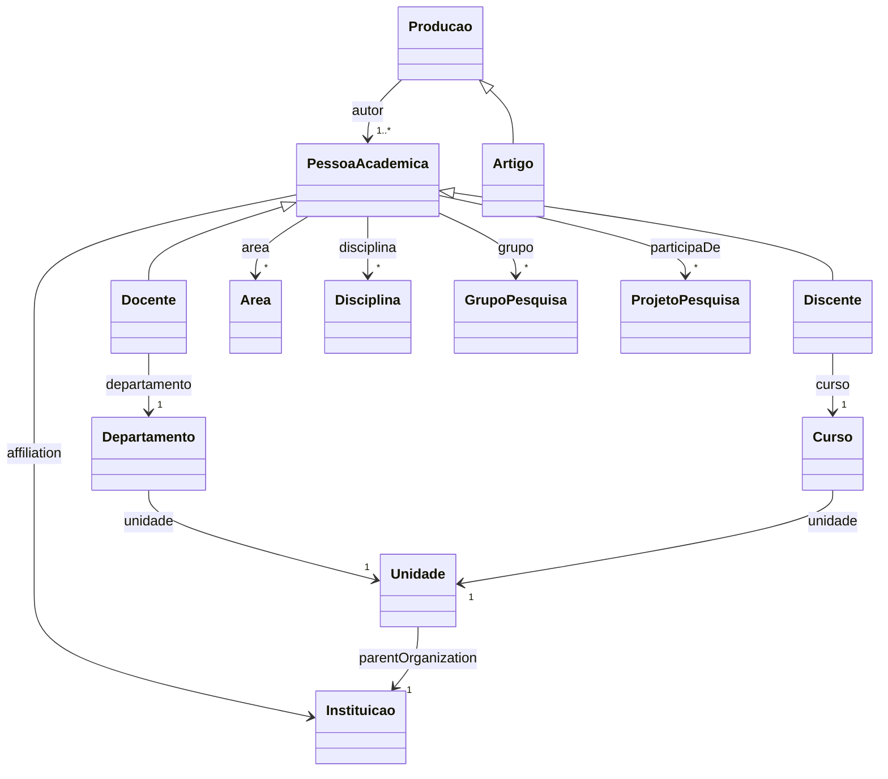

# Modelo conceitual e dicionário de dados

## Relações do domínio

Uma pessoa pode compartilhar áreas e projetos com outras pessoas. Uma produção aponta para seus autores. Uma pessoa chega à unidade pelo departamento, se docente, ou pelo curso, se discente. A instituição é `schema:CollegeOrUniversity`.

## Dicionário dos campos estruturados

| Campo | Tipo e regra | Representação |
| --- | --- | --- |
| Chaves das coleções | Identificadores únicos em minúsculas, com números e hífens permitidos. São estáveis depois de publicados. | IRIs relativos da página de perfil ou das âncoras de recursos. |
| `instituicao` | Nome textual de uma instituição comum ao diretório. | `schema:name` de `schema:CollegeOrUniversity`. |
| `nome` ou valor textual do recurso | Texto em português que identifica perfil, unidade, disciplina, grupo ou outro recurso. | `schema:name` com idioma `pt-BR`. Para áreas, também `skos:prefLabel`. |
| `tipo` do perfil | Enumeração `Docente` ou `Discente`. | `rdf:type` com a classe correspondente. |
| `funcao`, `apresentacao` | Textos que descrevem papel acadêmico e trajetória. | `schema:jobTitle`, `schema:description`. |
| `departamento`, `curso` | Identificador do vínculo. Um departamento para docente ou um curso para discente. | `acad:departamento` ou `acad:curso`. |
| `unidade` | Um identificador em cada departamento ou curso. Deve existir em `unidades`. | `acad:unidade`. |
| `formacao` | Lista de textos com títulos e, quando conhecido, o ano ou estado da formação. | `acad:formacao` por entrada. |
| `ingresso` | Ano de quatro dígitos, opcional para discentes. | `acad:ingresso` com tipo `xsd:gYear`. |
| `areas`, `disciplinas`, `grupos`, `projetos` em um perfil | Listas de zero ou mais identificadores de recursos existentes. | `acad:area`, `acad:disciplina`, `acad:grupo`, `acad:participaDe`. |
| `links` | Mapa opcional de rótulos visíveis para URLs HTTPS de portais. | `acad:portalAcademico` aponta para a IRI do portal. O rótulo é informação da apresentação. |
| `wikidata` | IRI externa opcional do conceito que se aproxima da área local. | `skos:closeMatch`. |
| `descricao` do projeto | Texto de escopo do projeto. | `schema:description`. |
| `tipo`, `ano`, `autores` da produção | Tipo `Artigo` ou `Trabalho acadêmico`, ano de quatro dígitos e pelo menos um identificador de perfil. | Classe `acad:Artigo` ou `acad:Producao`, `acad:ano` e um `acad:autor` por pessoa. |
| `fonte`, `licenca`, `atualizadoEm` | Texto de origem, IRI da licença e data ISO `AAAA-MM-DD`. | `dct:description`, `dct:license`, `dct:modified` em `dcat:Dataset`. `dct:source` aponta para o JSON servido pelo site. |

## Ontologia de aplicação

`Docente` e `Discente` especializam `PessoaAcademica`, alinhada por subclasse a `schema:Person`. `Unidade`, `Departamento` e `GrupoPesquisa` especializam `schema:Organization`. `Area` especializa `skos:Concept`. `Producao` especializa `schema:CreativeWork` e `Artigo` especializa tanto `Producao` quanto `schema:ScholarlyArticle`. `Curso`, `Disciplina` e `ProjetoPesquisa` são classes locais.

| Propriedade local | Domínio | Alcance |
| --- | --- | --- |
| `departamento` | `Docente` | `Departamento` |
| `curso` | `Discente` | `Curso` |
| `unidade` | União de `Departamento` e `Curso` | `Unidade` |
| `area` | `PessoaAcademica` | `Area` |
| `disciplina` | `PessoaAcademica` | `Disciplina` |
| `grupo` | `PessoaAcademica` | `GrupoPesquisa` |
| `participaDe` | `PessoaAcademica` | `ProjetoPesquisa` |
| `autor` | `Producao` | `PessoaAcademica` |
| `formacao` | `PessoaAcademica` | `xsd:string` |
| `ingresso` | `Discente` | `xsd:gYear` |
| `ano` | `Producao` | `xsd:gYear` |
| `portalAcademico` | `PessoaAcademica` | IRI de um portal. Alcance OWL aberto. |

`grupo` especializa `schema:memberOf` e `autor` especializa `schema:author`. No escopo do diretório, as duas categorias de pessoa são disjuntas, os docentes têm exatamente um departamento e os discentes exatamente um curso. O OWL expressa esses axiomas sob a hipótese de mundo aberto. O gerador verifica separadamente os vínculos e referências explícitos no JSON. As consultas usam as relações efetivamente gravadas no RDF e podem ser executadas sem um raciocinador OWL.

As duas serializações contêm o mesmo grafo de ontologia. [Turtle](../ontologia.ttl) · [OWL em RDF/XML](../ontologia.owl)
